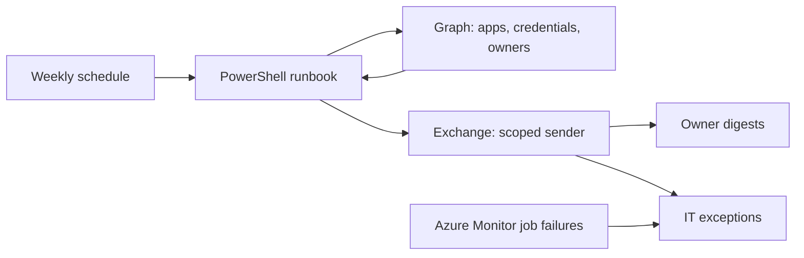

# Azure app credential expiry notifications

A small Azure Automation solution that emails app registration owners about expiring client secrets and certificates. It runs weekly, combines credentials into one digest per owner, and sends ownership gaps and expired credentials to IT.

It uses native Azure and Microsoft 365 services: Resource Manager/Bicep, Automation, managed identity, Graph, Exchange Online Application RBAC, and Azure Monitor. No database, website, stored password, or expiring authentication secret is required.

## What we built

| Credential status | Action |
| --- | --- |
| More than 60 days remaining | No email |
| More than 30, up to 60 days | Owner digest: Upcoming expiry |
| More than zero, up to 30 days | Owner digest: Action required |
| Already expired | IT exception digest |
| Expiring with no emailable user owner | IT exception digest |

Thresholds are configurable. All emailable user owners get their relevant digest. Owners with several affected apps get one combined email. Service principal owners cannot receive mail. Addresses come from Graph's user `mail` property; sign-in names are not assumed to be email addresses. Guests work when `mail` contains an address.

Reminders repeat weekly while credentials remain in scope. There is no notification ledger. First detection can occur almost seven days after entering a warning window. These are recurring digests, not exactly-once reminders at day 60/30.

## How it works



1. Authenticate with the Automation account's system-assigned managed identity.
2. Read applications using Graph v1.0, following pagination.
3. Check `passwordCredentials` and `keyCredentials` expiration in UTC.
4. Resolve owners and email addresses for affected applications.
5. Group unexpired credentials by owner; prepare IT exceptions separately.
6. Submit HTML emails through Graph `sendMail` using the chosen mailbox.
7. Log a summary and submission failures. Retry temporary reads. Read failures stop the run before sending partial digests.

Emails contain app name, client ID, credential type/name/ID, expiry, days left, urgency, and an app registration link. Directory-supplied values are HTML-escaped. The script never retrieves secret values, rotates credentials, or changes apps.

An expiring credential may already have a replacement. Adding one does not suppress the old credential's warning. Owners should update the consuming workload, validate it, then remove the old credential.

## Package contents

| File | Purpose |
| --- | --- |
| `Send-CredentialDigest.ps1` | Production runbook |
| `deploy/config.example.json` | Copy and customize settings |
| `deploy/main.bicep`, `deploy/main.json` | Native Azure template; JSON is precompiled |
| `deploy/Deploy.ps1` | Azure resources, Graph grants, Exchange setup |
| `deploy/Test-Deployment.ps1` | Dry run, redirected test, owner test, job inspection |
| `deploy/Enable-Schedule.ps1` | Enable/update/disable weekly delivery |
| `deploy/Common.ps1` | Shared configuration/API helpers |
| `Test-CredentialDigest.ps1`, `deploy/Test-Package.ps1` | Offline checks |

The ZIP excludes original tenant IDs, config, logs, previews, and development helpers. The original workspace retains `Dev-Test-Record.md` separately; it is not shipped.

## Prerequisites and permissions

Use PowerShell 7.4+, a current Azure CLI, and the Microsoft.Graph.Authentication and ExchangeOnlineManagement modules. Use a dedicated Automation account and preferably a dedicated resource group.

The public-cloud Azure subscription, app registrations, and Exchange mailbox must be in the same Entra tenant. Sovereign-cloud endpoints are not configured. An active Exchange email-capable subscription is required. E5 is not required. A standard shared mailbox up to 50 GB without advanced features normally needs no separate license; people accessing it need their own appropriate Exchange license. The automation identity needs no mailbox license. An existing user mailbox must be licensed appropriately.

The subscription's `Microsoft.Automation` and `Microsoft.Insights` resource providers must be registered. A subscription administrator can register them if deployment reports MissingSubscriptionRegistration. A resource-group Contributor may not have subscription-wide provider-registration rights.

Azure Automation and metric alerts may incur charges. Check current pricing/licensing; this is not a promise of a zero-cost deployment.

| Setup area | Administrative access |
| --- | --- |
| Azure | Contributor on target resource group; subscription permission to create the group if absent |
| Graph permission grants | Privileged Role Administrator or Global Administrator with consent rights; activate PIM if needed |
| Exchange app roles/scopes | Organization Management or equivalent permissions for those commands |
| Optional shared mailbox creation | Exchange recipient-management permissions |

Azure CLI needs an explicit target-tenant sign-in. Graph and Exchange use separate interactive setup sign-ins. **Normal interactive sign-in is the default**: run Deploy without `-DeviceLogin` for the Microsoft browser/broker sign-in supported by your installed modules. MFA and Conditional Access still apply. Device code is an explicit optional mode; omit it in tenants that block that flow. Setup credentials are not stored in the package or used by scheduled jobs.

The weekly runbook uses Azure managed identity, not a user sign-in or device code. Disabling device code authentication for users does not make this automation depend on an interactive login.

The Graph setup session requests delegated `Application.Read.All` and `AppRoleAssignment.ReadWrite.All` to grant roles. Those are deployment-session permissions. The managed identity receives only:

- Graph **Application.Read.All**: applications and owner relationships.
- Graph **User.ReadBasic.All**: basic user information, including email.
- Exchange **Application Mail.Send**, scoped exclusively to the sender mailbox.

Do not add tenant-wide Graph `Mail.Send`: Entra grants and Exchange Application RBAC grants are additive. The runbook has no directory/application write permissions or mailbox read access.

## Deploy in another tenant

### 1. Install tools, sign in, copy config

In PowerShell 7.4+:

```powershell
Install-Module Microsoft.Graph.Authentication -Scope CurrentUser
Install-Module ExchangeOnlineManagement -Scope CurrentUser
az login --tenant YOUR-TENANT-GUID
az account set --subscription YOUR-SUBSCRIPTION-GUID
Copy-Item ./deploy/config.example.json ./config.json
```

[Install Azure CLI](https://learn.microsoft.com/cli/azure/install-azure-cli).

Edit `config.json`. It contains settings, not credentials; keep it out of source control. Scripts reject an Azure CLI context that differs from config.

### 2. Choose a mailbox

**Existing mailbox, default:** set `senderMailbox` to an existing user/shared mailbox's primary SMTP address and leave `createSharedMailbox` as `false`. Setup stops if absent and does not silently create one.

**Create shared mailbox:** set `createSharedMailbox` to `true`, choose `senderMailbox` and `sharedMailboxName`. The domain must already be accepted in Exchange. Setup creates only if absent and reuses it on repeat runs. It does not assign licenses or grant people mailbox access.

Alternatively create it manually under Microsoft 365 admin center > Teams & groups > Shared mailboxes, then use existing-mailbox mode. Allow provisioning time.

### 3. Configuration reference

| Setting | Meaning |
| --- | --- |
| `tenantId`, `subscriptionId` | Target GUIDs |
| `resourceGroup`, `location` | Group and Azure region, e.g. `centralus` |
| `automationAccountName` | Dedicated account name; keep stable on redeployment |
| `exchangeAdminUpn` | Administrator for Exchange setup |
| `senderMailbox` | Sender primary SMTP address |
| `createSharedMailbox` | JSON `true`: create if absent; `false`: require existing |
| `sharedMailboxName` | Display name used only at creation |
| `fallbackRecipient` | IT exceptions and Azure Monitor failure recipient |
| `testRecipient` | Inbox for redirected tests |
| `warningDays`, `urgentDays` | Defaults 60/30; urgent must not exceed warning |
| `enableFailureAlert` | Create failure alert/action group; default true |
| `scheduleTimeZone`, `scheduleDay`, `scheduleHour` | Defaults `America/New_York`, `Monday`, `9`; local hour 0-23 |

Use JSON booleans, not strings, for mailbox creation/alerts. External recipients require permitted external delivery.

### 4. Deploy resources and permissions

```powershell
./deploy/Deploy.ps1 -ConfigPath ./config.json
```

Optional device sign-in, only where tenant policy permits it:

```powershell
./deploy/Deploy.ps1 -ConfigPath ./config.json -DeviceLogin
```

This performs an incremental ARM deployment using `main.json`, uploads/publishes the local runbook with Azure REST, grants the two Graph read roles, and configures Exchange's service principal, sender scope and role. On a fresh deployment it creates no weekly schedule.

For separate administrators or to retry a stage:

```powershell
./deploy/Deploy.ps1 -ConfigPath ./config.json -Stage Azure
./deploy/Deploy.ps1 -ConfigPath ./config.json -Stage Directory
./deploy/Deploy.ps1 -ConfigPath ./config.json -Stage Mailbox
```

Each admin needs their stage's rights; Directory/Mailbox also read the Azure identity. Use a fresh PowerShell session when switching tenants. Exchange setup verifies the connected tenant before changes.

Existing grants/mailboxes/service principals are reused. Conflicting role assignments stop setup for review. Fix a failed stage and rerun it. Avoid deleting/recreating the Automation account: its identity changes and needs new grants.

If another deployment already has an equivalent mailbox-specific Exchange scope, setup reuses it: Exchange rejects duplicate scope definitions. Otherwise setup creates a deterministic sender scope. Each deployment has its own role assignment, even when the sender/scope is shared. It never changes another deployment's scope filter.

Azure Monitor may send a verification email to `fallbackRecipient`. Complete that expected action-group verification. Failure alerts are independent of the digest sender mailbox.

### 5. Preview and test

Start with known test applications. Use client IDs, not object IDs:

```powershell
$apps = @('FIRST-APP-CLIENT-GUID', 'SECOND-APP-CLIENT-GUID')
./deploy/Test-Deployment.ps1 -ConfigPath ./config.json -Mode DryRun -ApplicationIds $apps
```

The command prints a job ID/state. Azure may take minutes to start it. Inspect the same job rather than starting another:

```powershell
./deploy/Test-Deployment.ps1 -ConfigPath ./config.json -JobId JOB-GUID
```

Verify completion, credentials, intended recipients, and exceptions. Dry-run output contains addresses/HTML; restrict log access.

Send to the configured test inbox, then inspect the printed job ID:

```powershell
./deploy/Test-Deployment.ps1 -ConfigPath ./config.json -Mode TestInbox -ApplicationIds $apps
```

The copy has a TEST banner showing the intended recipient. Confirm receipt, fields, and links.

Test actual owner routing without an override:

```powershell
./deploy/Test-Deployment.ps1 -ConfigPath ./config.json -Mode Owners -ApplicationIds $apps
```

This sends to all emailable owners of selected apps. Confirm receipt. Exchange admin center > Mail flow > Message trace can verify transport status. Graph acceptance and job success do not prove delivery.

Omit `ApplicationIds` to scan the tenant. Before activation, run a tenant-wide dry run and review intended recipients.

### 6. Activate weekly delivery

After successful testing:

```powershell
./deploy/Enable-Schedule.ps1 -ConfigPath ./config.json
```

This creates/enables one weekly schedule, with no test override or application allowlist. It scans all registrations and honors the time zone including daylight-saving changes. Default: Monday 09:00 Eastern.

Stop recurring mail:

```powershell
./deploy/Enable-Schedule.ps1 -ConfigPath ./config.json -Disable
```

The script manages `Weekly-Owner-Digest` and its fixed binding only. It does not remove other schedules; avoid creating duplicate bindings.

## Operation and maintenance

- Review Automation > Runbooks > Send-CredentialDigest > Jobs after the first scheduled run, then periodically.
- Assign an operational owner. Verify successful execution within eight days; no independent missed-run watchdog is deployed.
- Failure alerts cover Failed, Stopped, Suspended. They do not catch jobs that never start or mail rejected after API acceptance.
- Investigate IT ownership gaps and expired credentials. Expired entries repeat until removed.
- Manual reruns repeat mail. Read retries are automatic; ambiguous sends are not retried to avoid duplicates.
- Local config edits alone do not change Azure. Rerun the relevant stage and schedule command.
- For code/sender changes: disable schedule, deploy/configure, test, enable. Deploy does not disable an already-active schedule.
- For thresholds, recipients or time: test changes and rerun Enable-Schedule. Parameters are stored in Azure, not read from your local config.
- Incremental deployment with `enableFailureAlert=false` skips creation but does not delete previously deployed alerts; disable those in Azure Monitor if needed.
- Maintain modules/runtime. The template pins a known working Az bundle; test upgrades. After editing Bicep, rebuild JSON with `az bicep build --file ./deploy/main.bicep`.
- This package targets fresh deployments. Before managing the original dev installation with it, disable the older development schedule, which has a different name/binding.

## Troubleshooting

| Symptom | Action |
| --- | --- |
| Wrong tenant | Sign into configured tenant/subscription; fresh PowerShell session |
| Graph grant denied | Activate required Entra role and consent to setup scopes |
| New identity not found | Replication can lag; setup retries briefly, then rerun Directory stage |
| Exchange says unlicensed after purchase | Verify email-capable subscription/provisioning; retry fresh/device login. Our cached session returned this error after portal creation succeeded |
| Sender not found | Check primary address, tenant, provisioning; create only if intended |
| Send 403 | Check read grants, Exchange identity and scoped Mail.Send role; allow propagation time |
| No owner email | Check Owners and user `mail`; service principals cannot receive mail |
| Successful job but missing email | Check junk/quarantine, message trace, NDRs; submission is not delivery |
| External 550 5.7.708 | Sending-IP reputation block; contact Exchange support with trace/NDR |
| Duplicate mail | Check duplicate schedules/reruns and separate owner/IT digests |
| Wrong time | Check schedule zone and next run; expiry timestamps are UTC |

### Validation

The dev tenant passed a managed-identity dry run across 48 apps. Two affected apps produced one combined digest. Direct internal owner delivery passed, confirmed by message trace without an override. External owner lookup worked, but external delivery failed with 550 5.7.708 for two destinations.

The portable package was also deployed into a fresh resource group and Automation account in the dev tenant using an existing shared mailbox. Its new managed identity completed a tenant-wide dry run and sent one owner digest for the two affected credentials; Exchange message trace confirmed delivery. Schedule creation, repeated activation without a duplicate binding, and disabling were tested against Azure. The test schedule was left disabled so it would not duplicate the original deployment. This is a fresh-install test in the same tenant, not a separate-tenant test; complete acceptance checks in each target tenant.

That live package test found and corrected three setup issues: suppressed Graph device sign-in output, duplicate Exchange scopes when reusing a mailbox, and byte-array enumeration during runbook upload. Regression checks cover upload serialization and sender scope reuse. Offline checks also cover digest behavior, configuration, mailbox modes, and scheduling.

```powershell
./Test-CredentialDigest.ps1
./deploy/Test-Package.ps1
./deploy/Test-Schedule.ps1
```

These offline checks make no Azure/Microsoft 365 changes.

Schedule tests also verify first activation, repeated activation without duplicates, parameter updates, and disabling, using simulated Azure responses.

## Uninstall

Disable the schedule. Inspect Exchange's `<automationAccountName>-SendMail` assignment to identify its scope, then remove that assignment. Remove the scope only if no other assignments use it; scope reuse means another deployment may depend on it. Remove the deployment's Exchange service-principal registration if unused. Delete dedicated Azure resources/group only after checking for other needed resources. Recreating the account changes its identity and requires setup again.

Retain the sender mailbox by default, existing or newly created. Remove it and its mail only by explicit administrative decision. Azure deletion does not delete Exchange mailboxes.

## Scope and limits

Single public-cloud tenant; app registration secrets/certificates only. Enterprise app/SAML signing certs, Key Vault certificates, federation, rotation, Teams and tickets are outside this MVP. Weekly reminders are stateless and approximate at the warning boundaries. Exchange transport and external sending policies still apply.

## Microsoft references

- [Managed identity](https://learn.microsoft.com/azure/automation/enable-managed-identity-for-automation)
- [Runtime environments](https://learn.microsoft.com/azure/automation/manage-runtime-environment)
- [Graph applications](https://learn.microsoft.com/graph/api/application-list)
- [Graph owners](https://learn.microsoft.com/graph/api/application-list-owners)
- [Graph role assignments](https://learn.microsoft.com/graph/api/serviceprincipal-post-approleassignments)
- [Exchange Application RBAC](https://learn.microsoft.com/exchange/permissions-exo/application-rbac)
- [Shared mailbox requirements](https://learn.microsoft.com/microsoft-365/admin/email/about-shared-mailboxes)
- [Automation metric alerts](https://learn.microsoft.com/azure/automation/automation-alert-metric)
- [Provisioning delays](https://learn.microsoft.com/troubleshoot/exchange/user-and-shared-mailboxes/delays-provision-mailbox-sync-changes)
- [Error 550 5.7.708](https://learn.microsoft.com/troubleshoot/exchange/email-delivery/ndr/fix-error-codes-550-5-7-703-550-5-7-705-550-5-7-708-550-5-7-750)
